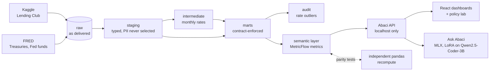
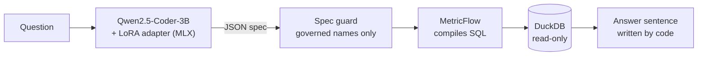

# Abaci

Abaci is a fictional online consumer lender, and this repo is its BI stack. The loan book is the real Lending Club book from 2007 to 2018 (about 2.3 million loans), relabeled as Abaci's. The project is framed as the first 90 days of Abaci's head of BI: inherit raw loan tapes, build one governed metric layer, and bring leadership four answers they can act on.

The name comes from Fibonacci's *Liber Abaci* (1202), the book that brought interest and loan math to Europe.

Everything runs locally on a MacBook: DuckDB, dbt, a MetricFlow semantic layer and, in a later step, a small AI analyst fine-tuned with Apple MLX. No cloud, and no data leaves the laptop.

## The four questions

1. **Which loans actually make us money?** Interest earned minus charge-offs, by grade, term, purpose and state.
2. **Are we pricing risk correctly?** The rate charged on each grade against the loss that grade actually realized, through the rate cycle.
3. **What happens if we change who we approve?** A credit policy lab built on real outcomes and the rejected-applications file.
4. **Was this loan worth it versus a Treasury?** Each loan's realized return against a Treasury of the same term bought on the same day. The gap is what Abaci was paid for credit risk.

## Architecture



## Quick start

You need Python 3.12 (`brew install python@3.12`). From the repo root:

```bash
make setup     # one time: creates .venv and installs the pinned packages
make sample    # the whole pipeline on a synthetic sample, about 30 seconds, no accounts needed
make all       # the real data: download (~1.6 GB), load, build, validate, test, report
```

Then the dashboards, the policy lab and Ask Abaci:

```bash
make app       # builds the React app and serves it with the API at http://127.0.0.1:8787
```

Ask Abaci runs a local model, so it needs an Apple Silicon Mac. The training set is in the repo and the adapter (27 MB) is trained locally:

```bash
make ask-setup # installs MLX and downloads Qwen2.5-Coder-3B 4-bit (~1.7 GB)
make ask-train # LoRA fine-tune, about 45 minutes on a 16 GB M-series MacBook, writes ask/adapters/
make ask-eval  # optional: base vs fine-tuned on held-out questions, writes ask/EVAL.md
```

Without an adapter, Ask Abaci falls back to the base model and says so on screen.

`make all` needs a Kaggle API token at `~/.kaggle/kaggle.json` (kaggle.com, Settings, API, Create New Token). The sample builds its own warehouse (`data/sample.duckdb`), so it never touches the real one (`data/abaci.duckdb`).

## Data

| Source | What it gives Abaci | Rows |
|---|---|---|
| [Lending Club accepted loans, 2007 to 2018](https://www.kaggle.com/datasets/wordsforthewise/lending-club) | The loan book: grade, rate, term, income, DTI, purpose, state, payments, outcome | ~2.3M |
| Lending Club rejected applications (same dataset) | The top of the approval funnel | ~27M |
| FRED `DGS3`, `DGS5`, `FEDFUNDS`, `UNRATE` | The risk-free benchmark matched to 36- and 60-month terms, plus the rate and labor backdrop | monthly |

Data files are git-ignored. They are large, and the Lending Club data is shared under Kaggle's terms.

## Layers

| Layer | What it does | Governance |
|---|---|---|
| `raw` | Source files loaded as text, exactly as delivered | Faithful copy, including the two summary lines at the end of the loan file |
| `staging` | Types, normalizes loan status, drops the summary lines | Employer title, free-text titles, zip code, member id and URL are never selected |
| `intermediate` | Monthly averages of the FRED series | |
| `marts` | `fct_loans` (realized economics and matched Treasury) and `fct_applications` (approved and rejected) | Public, owned by a named group, **enforced contracts** on every column |
| `audit` | Robust-z rate outlier screen | Warn-level test: new flags surface without blocking the build |
| `semantic` | 2 semantic models, 21 metrics, 4 saved queries | Every metric has an owner and a certified flag |

## How returns are measured

These definitions are where most hand-built lending analyses go wrong, so they are written once, in [`metrics.yml`](dbt/models/semantic/metrics.yml):

- **Net annualized return** = realized net profit / principal-years outstanding, on resolved loans. Principal-years is interest received divided by the rate, which recovers balance × time exactly. Averaging each loan's own annualized return instead lets a loan that defaulted in month two dominate the answer.
- **Treasury benchmark return** = the matched-term Treasury yield (3-year for 36-month loans, 5-year for 60-month) in the issue month, weighted the same way.
- **Excess return vs Treasury** = the difference: what Abaci was actually paid for credit risk.
- **Mature vintages only** for return questions. A loan is mature when its full term ended before the data cut-off (March 2019). Younger vintages have resolved early, which skews them toward defaults and prepayments.

## Checks

Every check runs on every PR in GitHub Actions and writes [`DATA_QUALITY.md`](DATA_QUALITY.md), which is posted to the job summary.

- **Completeness**: loan rows in the marts equal source rows, with every dropped line explained. Rejected applications tie the same way. Every issue month has both Treasury benchmarks.
- **Accuracy**: funded dollars, cash received and recoveries in `fct_loans` tie to the source file to the cent. Payment components add up to total payments.
- **Contracts** on every mart column. Renaming a column or changing a type fails the build until the contract changes with it.
- **Schema and range tests**: keys, accepted values, and ranges on rates, FICO, DTI, loss amounts and returns.
- **Unit tests** on hand-made loans for the five business rules that matter most: Treasury matched to term, charge-off loss net of recoveries and fees, vintage maturity, exposure capped when the stated rate is wrong, and no annualized return for loans that recovered more than they lent.
- **PII scan**: fails if any public column looks like a name, employer, zip code, address, phone or email.
- **Rate audit**: each loan's rate is scored against its sub-grade, term and month peers with a robust z-score.
- **Semantic layer validation** with `mf validate-configs` against the warehouse.
- **Parity**: the dashboard path (`mf query --saved-query`), the Python engine the AI analyst uses, and an independent pandas re-implementation from the raw CSVs that shares no code with dbt must agree on every metric for every grade, to 1e-9.
- **Proof the checks bite**: breaking a staging filter so it silently drops loans fails both reconciliation tests.

### What the checks found in the real data

- **Stated rate does not fit the installment (331 loans).** On some modified loans the source overwrote the stated rate, often to exactly 6.00%, so the installment implies a different rate. Dividing interest by the wrong rate overstated exposure (322,950 principal-years on a $33,575 loan), so these loans are flagged (`is_rate_inconsistent`) and their principal-years are capped at funded amount x term. A warn-level test keeps the count visible on every build.
- **Charge-offs that recovered more than they lent (44 loans).** Post-charge-off recoveries, net of collection fees, exceeded the funded amount, and that cash has no date. Annualizing over the one- or two-month holding period this implies compounded returns to over 1,000,000%. They get no per-loan annualized return (`is_recovery_driven`). Portfolio returns are unaffected, since they divide total net profit by total principal-years.
- **DTI of -1 (2 loans).** The source codes a missing debt-to-income ratio as -1, so staging treats it as missing.
- **Summary lines dropped (33).** The accepted-loans file includes 33 "Total amount funded in policy code" summary lines that are not loans. Staging drops them by rule, and the reconciliation accounts for each one.

## Dashboards: what the four questions found

Five screens in the Fold design system (`design/DESIGN.md`): Overview, Pricing, Policy Lab, vs Treasury and Ask Abaci. Every number comes from the semantic layer through the API, mostly via saved queries in [`saved_queries.yml`](dbt/models/semantic/saved_queries.yml), and every headline is computed from the data, so the same page tells the truth on the synthetic sample too. Each chart has a table view.

All returns below are on mature loans (785,915 loans, $10.4B).

1. **Which loans make money?** Every grade beat Treasuries, and grade F paid best (8.7% a year after losses). Education loans were the only purpose that earned less than a Treasury. Two results that look like insights and aren't:
   - **The 60-month premium is mostly a calendar effect.** 60-month loans returned 9.4% against 5.9% for 36-month loans, but mature 60-month loans only exist for the 2010 to 2014 vintages, Abaci's best years. On the same vintages the gap shrinks from 3.5 to 1.5 points.
   - **Verified income marks risk rather than reducing it.** Verified-income loans lost 10.2% of dollars against 5.9% for unverified ones, because verification was triggered on riskier applications.
2. **Are we pricing risk correctly?** No, not after 2013. Grades E to G were priced at about 21 points over Treasuries in both 2013 and 2016, but their lifetime losses climbed from 21% to 27% of dollars lent. The 2013 high-risk book returned 10.9% a year; the 2016 book returned **-3.8%**. The price barely moved while the borrowers got worse. This also corrects the step 2 reading that grade G is underpriced relative to F: year by year the vintage effect is far larger than the grade effect.
3. **What if we change who we approve?** See the policy lab below. The headline: **a higher FICO floor makes Abaci smaller, not richer.** A 700 floor keeps 42% of lending, nudges the return by a few hundredths of a point, and gives up over half a billion dollars of realized profit, because the loans it declines returned 6.5% a year.
4. **Was it worth it versus a Treasury?** Loans returned 6.6% a year against 1.0% for a same-term Treasury bought the same month: 5.6 points a year of credit premium. Only the 2007 and 2008 vintages lost to Treasuries. The leak is visible too: in 2013 Abaci kept 59% of the spread it priced, in 2016 just 26%.

## Credit policy lab

The lab replays a policy (FICO floor, DTI cap, income floor, grades, terms, and a repricing lever) against the loans Abaci actually made. It asks the semantic layer for the same governed metrics with extra filters, so it writes no metric SQL of its own ([`abaci/lab.py`](abaci/lab.py)). It is explicit about what the data can and cannot say:

- **Tightening is measured.** Declined loans are real loans with real outcomes, so their return and profit are facts. Kept plus declined always ties back to the baseline (tested).
- **Loosening is not.** Rejected applicants have no outcomes, so the lab counts how many would clear the new bars and labels them unpriced rather than inventing a default rate.
- **Repricing is static.** Extra basis points times principal-years of exposure, assuming no borrower walks away. It is an upper bound, and the screen says so.

## Ask Abaci, the local analyst

A 3-billion-parameter model (`Qwen2.5-Coder-3B-Instruct`, 4-bit) fine-tuned with LoRA on Apple MLX turns a question into a small JSON **query spec**: metrics, group-bys, filters, sort and limit. Nothing leaves the laptop.



The design choices that matter:

- **The model never writes SQL and never states a number.** It can only name governed metrics and dimensions. The spec guard ([`abaci/ask/spec.py`](abaci/ask/spec.py)) rejects unknown names, ratio building blocks, mixed models, unsafe filter values and unknown operators before MetricFlow sees anything, and the warehouse connection is read-only with file and network access switched off. The sentence is written by code from the returned rows.
- **Guardrails live in code, not in the model.** Return and loss questions automatically get the mature-vintages filter, and the answer says so.
- **It says no.** Questions about borrower names, contact details, forecasts or writes return `unsupported` with a reason.
- **Honest evaluation.** The 1,470 training examples are generated from templates over the catalog ([`abaci/ask/dataset.py`](abaci/ask/dataset.py)); every target is tested to validate and run. The test split uses metric and dimension wordings and question templates held out of training, and a second set of 30 questions was written by hand. The score that matters is execution match: does the generated query return the same rows as the reference?

Results on an M5 MacBook ([`ask/EVAL.md`](ask/EVAL.md), `make ask-eval`). The base model gets four worked examples in its prompt; the fine-tuned model gets none.

| Model | Held-out generated (150) | Handwritten (30) | Valid spec | Latency |
|---|---:|---:|---:|---:|
| Base Qwen2.5-Coder-3B, few-shot | 61% | 53% | 77 to 91% | 0.8s |
| **Fine-tuned (LoRA)** | **79%** | **70%** | **98 to 100%** | 0.9s |

Execution match, so a wrong spec that happens to return the right rows still counts as right. The fine-tune lifts accuracy by 17 to 18 points and almost never produces an invalid spec. The handwritten misses are listed in `EVAL.md` and fall into three groups: comparative questions ("did 60-month beat 36-month?") that the templates never covered, ambiguous wording ("loan volume" read as a count, not dollars), and two refusals it missed on new phrasings (a forecast, and an `UPDATE` statement it turned into a harmless read-only count). The guard means a miss gives a wrong-but-governed answer, never a made-up number or a write. The next training round should add comparative and refusal templates.

Training takes about 45 minutes on an M-series MacBook with 16 GB (`make ask-train`, config in [`ask/lora.yaml`](ask/lora.yaml)): 600 iterations, batch 4, rank-8 LoRA on 16 layers, loss on the answer only.

## Layout

```
ingest/            download (Kaggle, FRED), synthetic sample, raw loader
dbt/models/        staging/  intermediate/  marts/  audit/  semantic/
dbt/tests/         reconciliation, PII and business-rule tests
abaci/             semantic-layer client, read-only warehouse access, API server, policy lab
abaci/ask/         Ask Abaci: query spec guard, prompt, training-set generator, MLX inference, eval
app/               React dashboards (Vite, TypeScript, hand-built SVG charts in the Fold system)
ask/               fine-tuning data, LoRA config, EVAL.md (the trained adapter stays local, git-ignored)
parity/            independent pandas recompute and parity tests
python_tests/      ingest tests
quality/           DATA_QUALITY.md writer
design/            Abaci design system (tokens.css, DESIGN.md)
```
