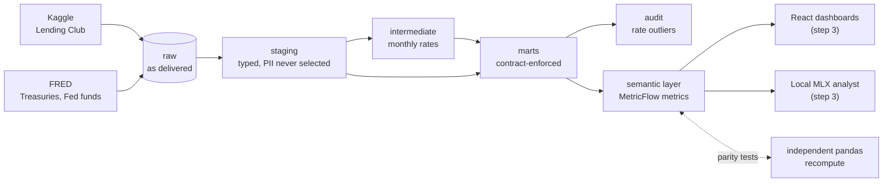

# Abaci

Abaci is a fictional online consumer lender, and this repo is its BI stack. The loan book is the real Lending Club book from 2007 to 2018 (about 2.3 million loans), relabeled as Abaci's. The project is framed as the first 90 days of Abaci's head of BI: inherit raw loan tapes, build one governed metric layer, and bring leadership four answers they can act on.

The name comes from Fibonacci's *Liber Abaci* (1202), the book that brought interest and loan math to Europe.

Everything runs locally on a MacBook: DuckDB, dbt, a MetricFlow semantic layer and, in a later step, a small AI analyst fine-tuned with Apple MLX. No cloud, and no data leaves the laptop.

## The four questions

1. **Which loans actually make us money?** Interest earned minus charge-offs, by grade, term, purpose and state.
2. **Are we pricing risk correctly?** The rate charged on each grade against the loss that grade actually realized, through the rate cycle.
3. **What happens if we change who we approve?** A credit policy lab built on real outcomes and the rejected-applications file.
4. **Was this loan worth it versus a Treasury?** Each loan's realized return against a Treasury of the same term bought on the same day. The gap is what Abaci was paid for credit risk.

## Architecture



## Quick start

You need Python 3.12 (`brew install python@3.12`). From the repo root:

```bash
make setup     # one time: creates .venv and installs the pinned packages
make sample    # the whole pipeline on a synthetic sample, about 30 seconds, no accounts needed
make all       # the real data: download (~1.6 GB), load, build, validate, test, report
```

`make all` needs a Kaggle API token at `~/.kaggle/kaggle.json` (kaggle.com, Settings, API, Create New Token). The sample builds its own warehouse (`data/sample.duckdb`), so it never touches the real one (`data/abaci.duckdb`).

## Data

| Source | What it gives Abaci | Rows |
|---|---|---|
| [Lending Club accepted loans, 2007 to 2018](https://www.kaggle.com/datasets/wordsforthewise/lending-club) | The loan book: grade, rate, term, income, DTI, purpose, state, payments, outcome | ~2.3M |
| Lending Club rejected applications (same dataset) | The top of the approval funnel | ~27M |
| FRED `DGS3`, `DGS5`, `FEDFUNDS`, `UNRATE` | The risk-free benchmark matched to 36- and 60-month terms, plus the rate and labor backdrop | monthly |

Data files are git-ignored. They are large, and the Lending Club data is shared under Kaggle's terms.

## Layers

| Layer | What it does | Governance |
|---|---|---|
| `raw` | Source files loaded as text, exactly as delivered | Faithful copy, including the two summary lines at the end of the loan file |
| `staging` | Types, normalizes loan status, drops the summary lines | Employer title, free-text titles, zip code, member id and URL are never selected |
| `intermediate` | Monthly averages of the FRED series | |
| `marts` | `fct_loans` (realized economics and matched Treasury) and `fct_applications` (approved and rejected) | Public, owned by a named group, **enforced contracts** on every column |
| `audit` | Robust-z rate outlier screen | Warn-level test: new flags surface without blocking the build |
| `semantic` | 2 semantic models, 21 metrics, 4 saved queries | Every metric has an owner and a certified flag |

## How returns are measured

These definitions are where most hand-built lending analyses go wrong, so they are written once, in [`metrics.yml`](dbt/models/semantic/metrics.yml):

- **Net annualized return** = realized net profit / principal-years outstanding, on resolved loans. Principal-years is interest received divided by the rate, which recovers balance × time exactly. Averaging each loan's own annualized return instead lets a loan that defaulted in month two dominate the answer.
- **Treasury benchmark return** = the matched-term Treasury yield (3-year for 36-month loans, 5-year for 60-month) in the issue month, weighted the same way.
- **Excess return vs Treasury** = the difference: what Abaci was actually paid for credit risk.
- **Mature vintages only** for return questions. A loan is mature when its full term ended before the data cut-off (March 2019). Younger vintages have resolved early, which skews them toward defaults and prepayments.

## Checks

Every check runs on every PR in GitHub Actions and writes [`DATA_QUALITY.md`](DATA_QUALITY.md), which is posted to the job summary.

- **Completeness**: loan rows in the marts equal source rows, with every dropped line explained. Rejected applications tie the same way. Every issue month has both Treasury benchmarks.
- **Accuracy**: funded dollars, cash received and recoveries in `fct_loans` tie to the source file to the cent. Payment components add up to total payments.
- **Contracts** on every mart column. Renaming a column or changing a type fails the build until the contract changes with it.
- **Schema and range tests**: keys, accepted values, and ranges on rates, FICO, DTI, loss amounts and returns.
- **Unit tests** on hand-made loans for the five business rules that matter most: Treasury matched to term, charge-off loss net of recoveries and fees, vintage maturity, exposure capped when the stated rate is wrong, and no annualized return for loans that recovered more than they lent.
- **PII scan**: fails if any public column looks like a name, employer, zip code, address, phone or email.
- **Rate audit**: each loan's rate is scored against its sub-grade, term and month peers with a robust z-score.
- **Semantic layer validation** with `mf validate-configs` against the warehouse.
- **Parity**: the dashboard path (`mf query --saved-query`), the Python engine the AI analyst uses, and an independent pandas re-implementation from the raw CSVs that shares no code with dbt must agree on every metric for every grade, to 1e-9.
- **Proof the checks bite**: breaking a staging filter so it silently drops loans fails both reconciliation tests.

### What the checks found in the real data

- **Stated rate does not fit the installment (331 loans).** On some modified loans the source overwrote the stated rate, often to exactly 6.00%, so the installment implies a different rate. Dividing interest by the wrong rate overstated exposure (322,950 principal-years on a $33,575 loan), so these loans are flagged (`is_rate_inconsistent`) and their principal-years are capped at funded amount x term. A warn-level test keeps the count visible on every build.
- **Charge-offs that recovered more than they lent (44 loans).** Post-charge-off recoveries, net of collection fees, exceeded the funded amount, and that cash has no date. Annualizing over the one- or two-month holding period this implies compounded returns to over 1,000,000%. They get no per-loan annualized return (`is_recovery_driven`). Portfolio returns are unaffected, since they divide total net profit by total principal-years.
- **DTI of -1 (2 loans).** The source codes a missing debt-to-income ratio as -1, so staging treats it as missing.
- **Summary lines dropped (33).** The accepted-loans file includes 33 "Total amount funded in policy code" summary lines that are not loans. Staging drops them by rule, and the reconciliation accounts for each one.

## Layout

```
ingest/            download (Kaggle, FRED), synthetic sample, raw loader
dbt/models/        staging/  intermediate/  marts/  audit/  semantic/
dbt/tests/         reconciliation, PII and business-rule tests
abaci/             Python client for the semantic layer, read-only warehouse access
parity/            independent pandas recompute and parity tests
python_tests/      ingest tests
quality/           DATA_QUALITY.md writer
design/            Abaci design system (tokens.css, DESIGN.md)
```
